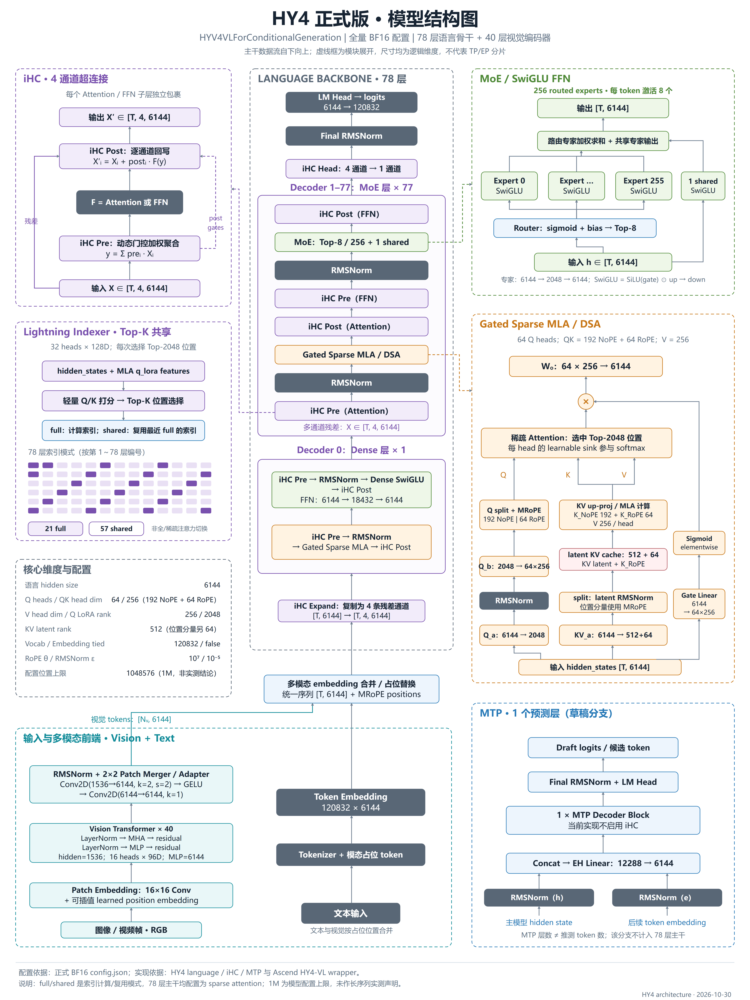

# HY4 正式版模型结构图

文件：

- [高清 PNG（4800 × 6400）](hy4-full-architecture.png)。
- [可编辑 SVG](hy4-full-architecture.svg)，文字保持为文本。
- [参数与配置校验值](architecture-facts.json)。

结构依据是本次正式全量 BF16 checkpoint 的配置，而非减层资产。配置 SHA256：
`1e1aaa28746437b67292db1e433b9a0b92b5461d43e5fe55598655571a1ee790`。

核对内容：78 层语言主干（首层 Dense，后 77 层 MoE）、6144 hidden、64 个 Q heads、QK 192+64、V head 256、Q LoRA 2048、KV latent 512、256 个 routed experts / Top-8 / 1 shared、4 通道 iHC、21 个 full indexer 层 / 57 个共享索引层、40 层 1536 hidden 视觉 Transformer 和 1 层 MTP。

具体实现依据：

- `vllm/models/hy_v4/nvidia/model.py`、`attention.py`、`hc.py`、`moe.py`、`mtp.py`，从已验证镜像源码只读提取。
- `vllm_ascend/patch/hy4_vl/vision.py` 和 `config.py`：核实视觉 LayerNorm、16×16 Patch Embedding、位置插值、2×2 Conv/GELU/1×1 Conv adapter 与输出维度。
- 参考布局：[CalvinXKY/InfraTech — Kimi K3 architecture](https://github.com/CalvinXKY/InfraTech/blob/main/models/kimi_k_3/kimi_k_3_architecture.jpg)。仅参考布局形式，图中模块、参数和连线按 HY4 配置与实现重新绘制。

阅读约定：

- 主干自下向上；侧面虚线框展开模块。维度是逻辑维度，不是 TP/EP 分片后的尺寸。
- MLA 的 K/V 展开是逻辑示意，底层可以使用吸收式 MLA / latent KV cache 等等价计算路径。
- full/shared 仅指 Top-K indexer 的计算或复用；并非 full attention 与 sparse attention 混合。78 个主干层的 layer_types 均为 deepseek_sparse_attention。
- 视觉 Transformer 使用 LayerNorm；语言主干和 adapter 使用图中标注的 RMSNorm。
- MTP 的 1 个结构层不等于运行时 num_speculative_tokens，也不计入 78 层主干。
- 1M 是配置声明的位置上限，不代表本次已验证百万 token 请求。

本次只绘图与核对静态资料，没有启动模型、bench 或精度测试。

